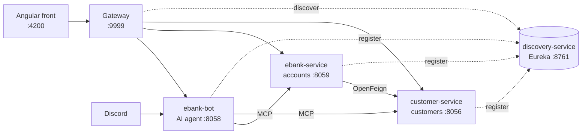

# E-Bank Microservices — Spring Cloud · Spring AI · MCP · Angular

A banking application built with a microservices architecture, featuring an AI assistant that answers questions about customers and bank accounts by calling the services through the **Model Context Protocol (MCP)**. The assistant is available through a REST API, an Angular web interface and a Discord bot.

Based on the course *"La Totale Architectures Micro-services — Spring Cloud, Spring AI, MCP, Angular"* by Professor Mohamed YOUSSFI, adapted to the latest versions (Spring Boot 4, Spring AI 2.0).

## Architecture



## Modules

| Module | Port | Role |
|---|---|---|
| `discovery-service` | 8761 | Eureka service registry |
| `customer-service` | 8056 | Customer management (JPA + H2), exposes MCP tools |
| `ebank-service` | 8059 | Bank account management (JPA + H2), calls `customer-service` via OpenFeign, exposes MCP tools |
| `ebank-bot` | 8058 | AI agent (Spring AI + OpenAI) with chat memory, uses the MCP tools of the other services; REST, streaming and Discord interfaces |
| `gateway-service` | 9999 | Spring Cloud Gateway (WebFlux) with dynamic routing through Eureka and CORS |
| `angular-front` | 4200 | Angular web UI: account list and chatbot with Markdown rendering and streaming |

### MCP tools exposed to the AI agent

- **ebank-service**: `getAllBankAccounts`, `getBankAccountById`, `save`
- **customer-service**: `getAllCustomers`, `findCustomerById`, `saveCustomer`

## Tech stack

- Java 21, Spring Boot 4.1, Spring Cloud 2025.1
- Spring Cloud Netflix Eureka, Spring Cloud Gateway (WebFlux), OpenFeign
- Spring AI 2.0 (OpenAI, chat memory, MCP client and server over Streamable HTTP)
- Spring Data JPA, H2 in-memory databases, SpringDoc OpenAPI (Swagger UI)
- JDA (Discord)
- Angular 21, ngx-markdown

## Prerequisites

- JDK 21
- Node.js and Angular CLI (`npm install -g @angular/cli`)
- An OpenAI API key
- A Discord bot token, with **Message Content Intent** enabled in the Discord Developer Portal

## Configuration

Secrets are not stored in the repository. Set them as environment variables before starting `ebank-bot`:

| Variable | Description |
|---|---|
| `OPENAI_API_KEY` | OpenAI API key |
| `DISCORD_TOKEN` | Discord bot token |

On Windows (PowerShell), then restart your terminal or IDE:

```powershell
setx OPENAI_API_KEY "your-key"
setx DISCORD_TOKEN "your-token"
```

## Build

From the project root:

```bash
./mvnw clean package -DskipTests
```

## Run

Start the services **in this order**, waiting for each one to finish starting:

```bash
./mvnw -pl discovery-service spring-boot:run
./mvnw -pl customer-service spring-boot:run   # wait until it is UP in Eureka
./mvnw -pl ebank-service spring-boot:run
./mvnw -pl ebank-bot spring-boot:run
./mvnw -pl gateway-service spring-boot:run
```

`ebank-service` creates sample accounts at startup by calling `customer-service`, so `customer-service` must be registered in Eureka first. The databases are in memory, so data is reset on every restart.

Then start the front end:

```bash
cd angular-front
npm install
ng serve
```

## Usage

| URL | Description |
|---|---|
| http://localhost:8761 | Eureka dashboard |
| http://localhost:4200 | Angular application |
| http://localhost:9999/EBANK-SERVICE/accounts | Bank accounts through the gateway |
| http://localhost:8058/chat?query=...&conversationId=... | Ask the AI agent (full answer) |
| http://localhost:8058/chatStream?query=...&conversationId=... | Ask the AI agent (streamed answer) |
| http://localhost:8059/swagger-ui/index.html | Swagger UI of `ebank-service` |
| http://localhost:8059/h2-console | H2 console (`jdbc:h2:mem:accounts-db`, user `sa`, no password) |

Example questions for the assistant:

- *Je veux la liste des comptes bancaires*
- *Quel est le solde du compte ...?*
- *Quels sont les comptes du client 1?*

The `conversationId` parameter keeps a separate chat memory per conversation.
